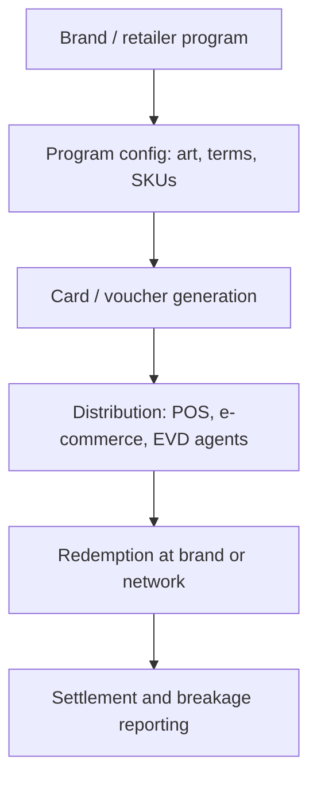

# Gift Card White-Label Program

An educational guide to **white-label gift card programs**: how a retailer or brand runs branded gift cards on a shared gift card system / electronic voucher platform, what the issuer controls versus the technology partner, and the operational pieces that keep inventory, branding, and redemption honest. Written for operators, retailers, and product teams looking at platforms in the [EVD System](https://evdsystem.com/) and [MoboGage](https://evdsystem.com/about-mobogage/) family.

---

## What Is a White-Label Gift Card Program?

A **white-label gift card program** lets a retailer, mall, or brand issue cards that carry their name, artwork, and terms, while the underlying **gift card system** (generation, inventory, PIN security, redemption, reporting) is provided by a specialist platform such as an electronic voucher / EVD stack.

Customers see the brand. Operations see a multi-tenant program: each brand has its own products, denominations, merchants of redemption, and settlement rules, on shared rails.

### Typical use cases

- **Retailers** selling store-branded open-loop or closed-loop gift cards at till and online
- **Mall operators** running a mall-wide card accepted by participating tenants
- **Telecom / VAS partners** bundling branded voucher products into existing EVD channels
- **Corporate buyers** purchasing bulk branded cards for staff or promotions

---

## How It Works

### Core components

| Component | Responsibility |
|-----------|----------------|
| **Program tenant** | Isolates one brand's products, users, and reports |
| **Card product catalogue** | Denominations, currencies, expiry, reloadable vs fixed |
| **Artwork and terms pack** | Face design, T&Cs, SMS/email templates under brand control |
| **Inventory / PIN vault** | Secure generation and allocation of card credentials |
| **Issuance channels** | In-store POS, web checkout, corporate bulk API, EVD agents |
| **Redemption network** | Where the card can be spent; authorisation and partial redeem |
| **Program reporting** | Sales, redemptions, outstanding liability, breakage |

See [docs/program-setup-checklist.md](./docs/program-setup-checklist.md) for a launch checklist.

---

## Issuer vs Platform Responsibilities

| Area | Brand / issuer typically owns | Platform typically owns |
|------|-------------------------------|-------------------------|
| Customer promise and T&Cs | Yes | Template support |
| Artwork and brand voice | Yes | Hosting and print-ready export |
| Where cards are sold | Merchant network decisions | Channel connectors |
| Funds / float and liability | Yes (regulatory reality) | Ledger tools and reports |
| PIN generation and HSM | Rarely | Security and audit controls |
| Fraud monitoring | Shared | Rules engine and alerts |

Clear contracts here prevent "who eats the fraud?" arguments after launch.

---

## Design Considerations

- **Closed-loop vs open-loop.** Closed-loop (spend only at the brand) is simpler. Open-loop or multi-merchant needs clearer settlement and scheme rules.
- **Liability reporting.** Outstanding unredeemed balances are a real balance-sheet item; daily reports must match the ledger.
- **Partial redemption.** Most retail programs need remaining balance after a partial spend — design the authorisation message for it.
- **Expiry and dormancy.** State expiry rules in the T&Cs customers actually see at purchase.
- **Bulk corporate issuance.** Needs separate KYC, purchase orders, and sometimes delayed activation.
- **Channel conflict.** The same SKU on mall kiosks, brand.com, and EVD agents needs one inventory truth.
- **No casino framing.** Gift cards are retail stored value / voucher products — keep educational content in that lane.

MoboGage's EVD System includes electronic voucher and gift-card oriented distribution capabilities, so white-label programs can sit on the same generation, inventory, and reseller channels used for telecom and retail vouchers when the operator configures branded products.

---

## FAQ

**What is a white-label gift card program?**
A branded gift card product line whose customer-facing identity belongs to a retailer or brand, while the technical gift card / voucher platform is operated by a specialist provider.

**Is a white-label card the same as a voucher PIN?**
Often the credential is a PIN or card number managed like an electronic voucher; packaging and brand rules make it a "gift card program" rather than a generic airtime voucher.

**Who holds customer liability?**
Usually the licensed issuer or the brand under local stored-value rules — not something to assume from software alone. Confirm with counsel.

**Can one platform run many brands?**
Yes; that is the multi-tenant program model: shared rails, isolated catalogues, artwork, and reports.

**How does this relate to MoboGage / EVD System?**
MoboGage provides electronic voucher and related distribution capabilities within EVD System. See [voucher management system](https://evdsystem.com/voucher-management-system-mobogage/) and [about MoboGage](https://evdsystem.com/about-mobogage/).

---

## Glossary (short)

- **White-label** — brand-facing product on a shared technology platform
- **Closed-loop** — redeemable only at defined merchants
- **Outstanding liability** — face value issued but not yet redeemed
- **Breakage** — unused value that expires or is recognised under accounting rules
- **Program tenant** — isolated brand configuration on a multi-tenant system

---

## Further Reading / Related Industry Resources

- [Voucher management system (MoboGage)](https://evdsystem.com/voucher-management-system-mobogage/) — EVD / voucher platform context
- [What is an electronic voucher?](https://evdsystem.com/evd-software/what-is-an-electronic-voucher/) — voucher concepts
- Related repo: [gift-card-system-architecture](https://github.com/iwtglobal/gift-card-system-architecture) — architecture notes for gift card systems

---

## License

Documentation in this repository is provided under the MIT License. See [LICENSE](./LICENSE).

*Educational material only. Not legal, regulatory, or financial advice. MoboGage and EVD System refer to offerings on evdsystem.com.*
